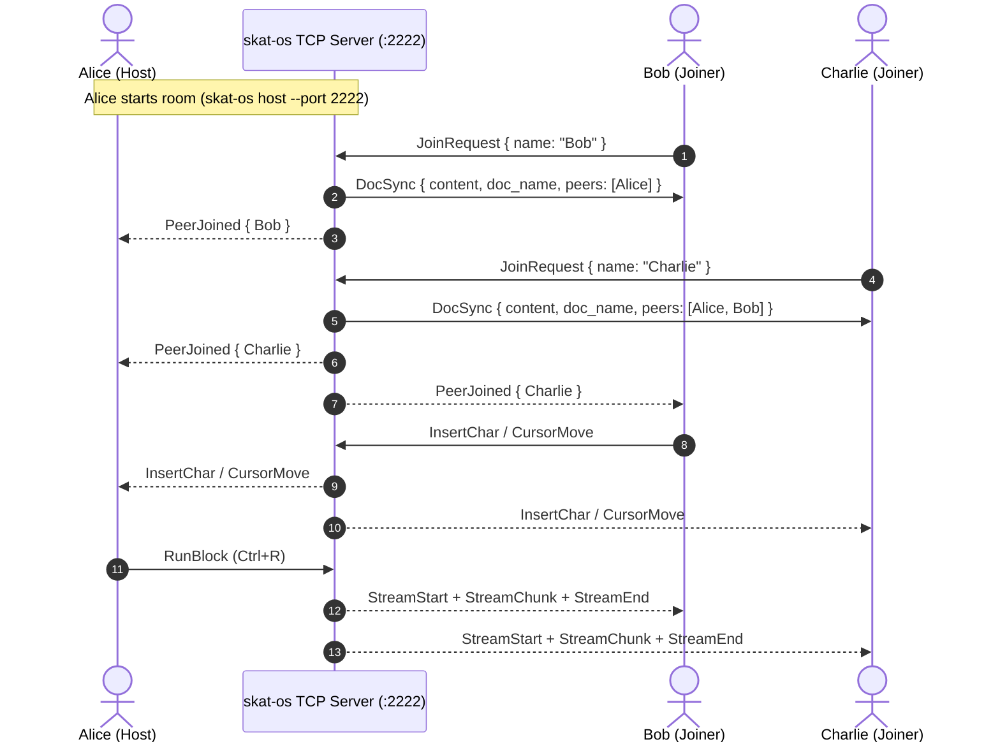
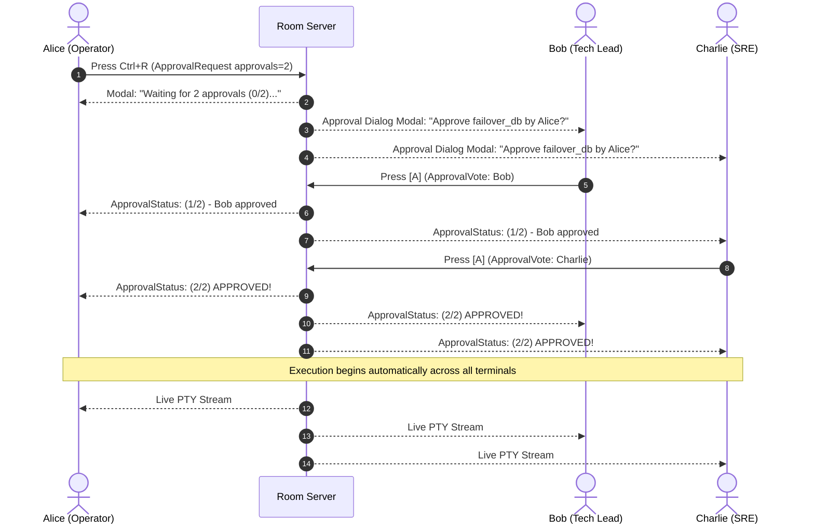

# Real-Time Multiplayer Collaboration

`skat-os` includes a built-in, zero-dependency **Multiplayer Collaboration Engine**. Teams can pair-write runbooks, review living documentation, co-execute dangerous production playbooks, and vote on execution approvals in real time directly from their terminals.

Unlike web-based notebooks or SaaS collaboration tools, `skat-os` multiplayer requires **zero cloud accounts, zero third-party servers, and zero telemetry**. All communication occurs over direct, lightweight TCP streams.

---

## 1. Architecture & Networking Overview

The multiplayer architecture is organized around an ephemeral or dedicated **Room Server**:



### Key Architectural Tenets
- **Direct TCP Socket**: Powered by `tokio::net::TcpListener` and `TcpStream` with framing for sub-millisecond latency.
- **Local Network & VPN Ready**: Works out of the box across LANs, VPNs, WireGuard, Tailscale, or SSH port forwarding tunnels (`ssh -R 2222:localhost:2222`).
- **Resilient Reconnection**: Clients automatically recover on reconnect; peer disconnects do not interrupt active sessions.

---

## 2. CLI Commands & Modes

### Starting a Collaborative Room (`skat-os host`)

To host a collaboration room and open the interactive TUI:

```bash
skat-os host --port 2222 --workspace ./docs --name Alice
```

#### Available Flags for `host`:
- `--port`, `-p`: TCP listening port (default: `2222`).
- `--workspace`, `-w`: Path to the markdown workspace directory.
- `--name`, `-n`: Collaborator display name (defaults to `$USER` environment variable).
- `--headless`: Run as a background headless server without launching the TUI.

### Joining an Existing Room (`skat-os join`)

To join an active session hosted on your network:

```bash
# Join local room
skat-os join 127.0.0.1:2222 --name Bob

# Join remote peer across LAN or VPN
skat-os join 192.168.1.100:2222 --name Charlie

# Join across Tailscale node
skat-os join 100.85.12.34:2222 --name Dana
```

### Dedicated Headless Server Mode

For team environments, run `skat-os` in headless daemon mode on a shared bastion or dev server:

```bash
skat-os host --port 2222 --workspace /srv/runbooks --headless
```

The headless process manages room synchronization, serves the latest document versions, coordinates execution broadcasts, and persists changes to disk without allocating terminal raw mode.

---

## 3. Wire Protocol & Handshake Lifecycle

All multiplayer events are serialized over the TCP connection using structured JSON messages (`CollabMessage`).

### Handshake Sequence
1. **`JoinRequest`**: The joining client sends `{ "JoinRequest": { "name": "Bob" } }`.
2. **`DocSync`**: The server replies with the complete document buffer, active filename, document version, assigned peer ID, and list of existing peers:
   ```json
   {
     "DocSync": {
       "content": "# Production Runbook\n...",
       "doc_name": "runbook.md",
       "version": 42,
       "your_id": "peer_b8f1a2",
       "peers": [
         {
           "id": "peer_000001",
           "name": "Alice",
           "color_index": 0,
           "cursor_line": 12,
           "cursor_col": 4
         }
       ]
     }
   }
   ```
3. **`PeerJoined`**: The server broadcasts the new collaborator's identity and assigned color to all existing peers.
4. **`PeerLeft`**: When a client socket closes, the server notifies all active participants and removes their cursor.

---

## 4. Real-Time Multi-Cursor & Name Badges

Collaborator movements and edits are visualized smoothly in the editor pane:

```
+-------------------------------------------------------+
| runbook.md                                            |
+-------------------------------------------------------+
| # Cluster Deployment                                  |
|                                                       |
| Step 1: Drain active node                             |
| kubectl drain node-01 --ignore-daemonsets [Bob]       |
|                                                       |
| Step 2: Upgrade kubelet [Alice]                       |
+-------------------------------------------------------+
```

### ANSI Peer Palette
Each collaborator is assigned a unique color from the ANSI terminal palette:
- `Cyan`, `Magenta`, `Yellow`, `Green`, `LightBlue`, `LightRed`, `LightCyan`, `LightMagenta`.

### Features
- **Floating Name Badges**: Teammates' cursors render with their name tag (e.g. `[Bob]`).
- **Sidebar Status & Status Bar**: The sidebar displays active peers with real-time cursor coordinates (`● Bob [L14:C5]`), while the status bar shows total peer count.
- **Terminal Resize Resilience**: Terminal window size differences are handled transparently; cursor positions remain aligned with character coordinates rather than terminal grid cells.

---

## 5. Shared Asynchronous Co-Execution

Collaborative runbooks allow distributed teams to co-execute and inspect commands together during incident response or planned maintenance:

### Shared Execution Workflow
1. **Triggering Execution**: Any peer can position their cursor on a code block and press **`Ctrl+R`**.
2. **Broadcast**: A `RunBlock` message is broadcast to the room. The host process initiates the PTY execution runner.
3. **Live Streaming Broadcast**:
   - `StreamStart`: Notifies all peers that execution has begun; output blocks transition to `[running]`.
   - `StreamChunk`: Incremental stdout/stderr chunks stream synchronously across all peers' screens in real time.
   - `StreamEnd`: Broadcasts completion and final exit code (`[exit: 0]`).
4. **Shared Interruption (`Ctrl+C`)**: If any peer presses `Ctrl+C` while a command is streaming, the cancellation signal propagates and terminates the child process.

### Synchronized Tasks & Parameters
- **Task Checklists (`ToggleTask`)**: When a teammate presses `Space` on `- [ ]`, the checkbox flips to `- [x]` on every connected terminal.
- **Parameter Adjustments (`ParamUpdate`)**: When a collaborator changes a form parameter (`ENV=prod`), the new value propagates immediately across the room.

---

## 6. Multiplayer Consensus Approvals (`approvals=N`)

For mission-critical operations (e.g., database failovers, production routing cuts, schema migrations), `skat-os` provides **Consensus Approval Gates**.

### Syntax
Specify the required number of peer approvals in the code block fence:

````markdown
```bash name=failover_db approvals=2 target="@prod_cluster" danger=true
echo "Initiating primary database failover..."
patronictl failover --candidate replica-02
```
````

### Approval Voting Lifecycle



### Consensus Rules
1. **Pre-Execution Lock**: The block will not execute until `approvals` distinct peer votes have been cast.
2. **Interactive Approval Modal**: Non-initiating peers see a dialog displaying:
   - Requesting collaborator name.
   - Target hosts and blast radius.
   - Redacted command preview.
   - Shortcut keys: **`A`** to Approve, **`R`** to Reject / Cancel.
3. **Audit Trail Logging**: When consensus is reached, the audit journal records the signatures of all approving peers alongside the execution record.

---

## 7. Network Security & Tunneling

Since `skat-os` communicates over standard TCP sockets, you can easily secure or expose rooms using industry-standard tooling:

### Running Over SSH Reverse Tunnels

If hosting on a local machine behind NAT or firewalls, expose the room through an SSH jump host:

```bash
# On your local machine (hosting room on port 2222):
skat-os host --port 2222 --name Alice

# In another terminal, forward port 2222 to your bastion host:
ssh -R 2222:localhost:2222 user@bastion.example.com

# Remote teammates can then join via the bastion:
skat-os join bastion.example.com:2222 --name Bob
```

### Running Over Tailscale / WireGuard
No special configuration required. Simply bind or connect using your Tailscale IP (e.g. `100.x.y.z:2222`).

---

## 8. Summary of Multiplayer Keybindings

| Key | Context | Action |
| :--- | :--- | :--- |
| **`Ctrl+R`** | On Code Block | Trigger shared execution or broadcast approval request |
| **`A`** | Approval Modal | Cast approval vote for requested execution |
| **`R`** / **`Esc`** | Approval Modal | Reject or dismiss approval request |
| **`Space`** | On Task Checkbox | Toggle checkbox and broadcast `ToggleTask` |
| **`Tab`** / **`Space`** | On Form Param | Modify parameter and broadcast `ParamUpdate` |
| **`Ctrl+C`** | Streaming Block | Cancel active execution across all connected peers |

---

## 9. Related Documentation

- **[Getting Started](getting-started.md)**: Workspace setup and navigation.
- **[Interactive Documents](interactive-documents.md)**: Code blocks, parameters, and tables.
- **[Mesh & Fleet Orchestration](mesh-and-fleet.md)**: Multi-host SSH remote execution.
- **[Security, Vault & Audit](security-vault-audit.md)**: Command guardrails, secret vault, and audit logs.
