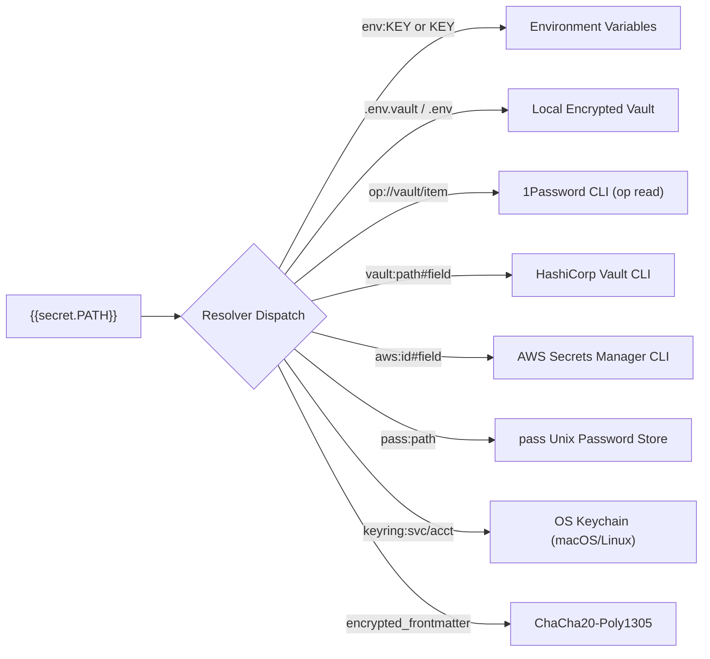
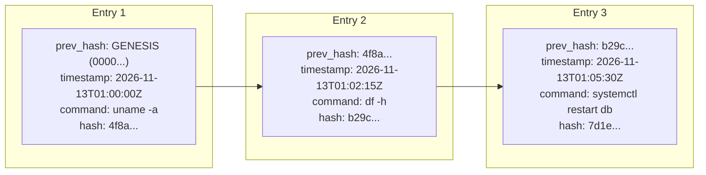

# Zero-Trust Security, Dynamic Vault & Audit Trails

In a Document Operating System where runbooks and playbooks can execute commands directly against production infrastructure, security cannot be an afterthought. `skat-os` implements a comprehensive **Zero-Trust Security Architecture** built on three foundational pillars:

1. **Dangerous Command Guardrails**: Static heuristic analysis and interactive approval gates.
2. **Dynamic Secret Vault**: Zero-leak credential resolvers, live output redaction, and ChaCha20-Poly1305 encrypted frontmatter.
3. **Immutable Execution Audit Trails**: SHA-256 cryptographic hash-chained execution journaling with timeline verification.

---

## 1. Dangerous Command Guardrails

Before any code block is executed, `skat-os` passes the script through a static heuristic security analyzer (`StaticAnalyzer`) to detect destructive operations, denial-of-service patterns, and accidental cluster wiping.

### Heuristic Detection Patterns

| Category | Patterns Flagged | Danger Level | Reason Reported |
| :--- | :--- | :--- | :--- |
| **Filesystem Wipe** | `rm -rf /`, `rm -rf /*`, `rm -rf .`, `rm -fr /`, `--no-preserve-root` | **CRITICAL** | Recursive filesystem wipe detected |
| **Drive Overwrite** | `mkfs`, `mkfs.ext4`, `dd of=/dev/sd*`, `dd of=/dev/nvme*` | **CRITICAL** | Raw disk block overwrite / format detected |
| **Database Deletion** | `DROP DATABASE`, `DROP SCHEMA` | **CRITICAL** | Database/schema destruction detected |
| **Table Truncation** | `DROP TABLE`, `TRUNCATE TABLE` | **HIGH** | Table drop or truncation detected |
| **Firewall Reset** | `iptables -F`, `iptables --flush`, `iptables -X` | **HIGH** | Firewall flush/reset detected |
| **Container / Cloud**| `kubectl delete ns`, `kubectl delete namespace`, `kubectl delete nodes` | **CRITICAL** | Cluster resource deletion detected |
| **Fork Bomb DoS** | `:(){ :|:& };:` | **CRITICAL** | Bash fork bomb denial of service detected |
| **Permissions Wipe**| `chmod -R 777 /`, `chmod -r 777 /*` | **HIGH** | Insecure root permissions overwrite detected |

### Fenced Block Safety Attributes

Authors can explicitly flag operations and configure interactive gates:

````markdown
```bash confirm="Are you sure you want to flush production cache?" danger=true blast_radius="critical"
redis-cli -h cache.prod.internal FLUSHALL
```
````

- `confirm="<prompt>"`: Overrides default safety prompt with a custom confirmation question.
- `danger=true`: Marks block as dangerous, enforcing the confirmation modal regardless of command text.
- `blast_radius="critical"` / `"high"`: Highlights the severity level in red or amber banners.
- `dry_run=true`: Injects `$SKAT_DRY_RUN=1` environment variable, enabling safe simulation runs.
- `approvals=N`: Requires consensus approval from $N$ collaborators in multiplayer sessions.

### Interactive Safety Confirmation Dialog

When a dangerous operation is detected or configured, `skat-os` pauses execution and displays a high-priority Ratatui modal:

```
+--------------------------------------------------------------------+
| ⚠ HIGH-BLAST-RADIUS EXECUTION GUARDRAIL                           |
+--------------------------------------------------------------------+
| Target:      ssh://ubuntu@db-primary.prod.internal                 |
| Reason:      Database/schema deletion detected ('DROP DATABASE')   |
| Command:     DROP DATABASE analytics_warehouse;                    |
|                                                                    |
| Type confirmation keyword or press [Enter] to confirm:             |
| > [ YES ]                                                          |
|                                                                    |
| [Enter] Proceed with execution     [Esc] Cancel safely             |
+--------------------------------------------------------------------+
```

---

## 2. Dynamic Secret Vault & Zero-Leak Credential Management

`skat-os` ensures sensitive tokens, database passwords, and API keys are **never stored in plaintext** or checked into git repositories.

### In-Memory Interpolation Syntax

Reference secrets in any code block or script using template notation:

```bash
curl -H "Authorization: Bearer {{secret.PROD_API_TOKEN}}" https://api.corp.internal/v1
```

Supported syntax variants:
- `{{secret.KEY}}`
- `{{secrets.KEY}}`

### Pluggable Credential Resolvers

`skat-os` resolves secret tokens on-the-fly using pluggable backend resolvers:



| Resolver Prefix | Description | Example Syntax | Command Invoked |
| :--- | :--- | :--- | :--- |
| `env:` (or bare) | Environment Variable | `{{secret.AWS_ACCESS_KEY}}` | `std::env::var("AWS_ACCESS_KEY")` |
| `.env.vault` | Workspace Dotenv Vault | `{{secret.DB_PASSWORD}}` | Parsed from `./.env.vault` |
| `op://` or `op:` | 1Password CLI | `{{secret.op://prod/api/token}}` | `op read <path>` |
| `vault:` | HashiCorp Vault | `{{secret.vault:secret/data/db#password}}` | `vault kv get -field=password secret/data/db` |
| `aws:` | AWS Secrets Manager | `{{secret.aws:prod/rds#password}}` | `aws secretsmanager get-secret-value --secret-id prod/rds` |
| `pass:` | Standard Unix `pass` | `{{secret.pass:corporate/db}}` | `pass show corporate/db` |
| `keyring:` | System Keychain | `{{secret.keyring:my-service/admin}}` | `security find-generic-password` (macOS) / `secret-tool` (Linux) |

---

## 3. ChaCha20-Poly1305 Encrypted Frontmatter

For sensitive runbooks that must be self-contained and shareable via Git, `skat-os` supports authenticated symmetric encryption directly inside document YAML frontmatter:

```yaml
---
secrets:
  nonce: "148f3b7c20a109e45d610012"
  ciphertext: "8e92bf1802a4...30fbc89a"
---

# Emergency Infrastructure Recovery Playbook
```

### Cryptographic Guarantees
- **Cipher**: **ChaCha20-Poly1305** Authenticated Encryption with Associated Data (AEAD) via Rust's `chacha20poly1305` crate.
- **Key Derivation**: 256-bit symmetric key derived from user passphrase using cryptographic SHA-256.
- **Monotonic Nonce**: 96-bit (12-byte) timestamped and monotonic counter nonce preventing replay attacks and catastrophic nonce reuse.
- **Zero Disk Exposure**: Plaintext secret values are held purely in memory within the `SecretVault` structure and discarded when `skat-os` terminates.

---

## 4. Zero-Leak Output Masking & Redaction

Even when secrets are required for execution, they must never leak into screen recordings, command output blocks, or audit logs:

### Automatic String Redaction
- Every resolved secret value (length $\ge 3$) is automatically registered in the vault's sensitive values registry.
- Before output chunks or stream bytes are rendered to the terminal or saved to disk, they pass through `SecretVault::mask()`.
- **Longest-String-First Replacement**: Secret values are sorted descending by length before masking. This ensures composite tokens are redacted in full before shorter substrings, preventing partial-leak exposure.
- Masked values appear cleanly as **`[REDACTED]`**:

```
=== Execution Output ===
Connecting to database: host=db.prod.internal user=admin password=[REDACTED]
Token [REDACTED] validated successfully.
```

### Masked Secret Form Parameters

For interactive forms requiring password or token entry, use the `secret` widget type:

```markdown
Access Token: {{param:secret:API_KEY=my_secret_token_123}}
```

- In the document editor, the value is always masked with bullets: `•••••••••••••••••••`.
- Navigating and editing maintains secret masking without exposing plaintext on screen.

---

## 5. Immutable Cryptographic Audit Log

Every command executed in `skat-os`—whether local, remote over SSH, or shared via multiplayer—is permanently recorded in an immutable, append-only journal:

```
<workspace>/.skat/audit.log
```

### SHA-256 Hash Chaining (Blockchain-Style Integrity)

Each audit entry is cryptographically linked to the previous entry's hash, forming an unbreakable SHA-256 hash chain:



If an unauthorized actor tampers with any command line, parameter, timestamp, or output preview in `.skat/audit.log`, every subsequent hash in the chain becomes invalid immediately.

### Audit Entry Schema

Entries are recorded as single-line JSON objects (`JSON-Lines`):

```json
{
  "timestamp": "2026-11-13T01:05:30.124Z",
  "execution_id": "exec_1763000000_584b4154",
  "doc_path": "runbook.md",
  "block_id": "service_restart",
  "collaborator": "Alice",
  "target_hosts": ["10.0.1.10", "10.0.1.11"],
  "command": "systemctl restart nginx",
  "params": {
    "CLUSTER": "prod-us",
    "DRY_RUN": "false"
  },
  "exit_code": 0,
  "duration_ms": 342,
  "output_preview": "nginx.service reloaded successfully.",
  "prev_hash": "b29c9e83...",
  "hash": "7d1e4a50..."
}
```

> [!IMPORTANT]
> The `command` and `output_preview` stored in the audit journal are automatically stripped of sensitive secrets using the vault redaction engine.

---

## 6. Command Palette Audit Log Viewer

Inspect the workspace execution history at any time without leaving `skat-os`:

1. Press **`Ctrl+K`** to open the Unified Command Palette.
2. Type `audit` and select **`View Audit Log`**.
3. An interactive timeline modal opens:

```
+----------------------------------------------------------------------------------+
| Execution Audit History  [ ✓ Chain Verified: 14/14 Entries Valid ]               |
+----------------------------------------------------------------------------------+
| TIME (UTC)           | USER    | TARGET      | BLOCK          | STATUS  | DURATION |
| 2026-11-13 01:05:30  | Alice   | 10.0.1.10   | restart_svc    | exit 0  | 342ms    |
| 2026-11-13 01:02:15  | Bob     | local       | check_disk     | exit 0  | 45ms     |
| 2026-11-13 00:58:40  | Alice   | @web_nodes  | ping_fleet     | exit 0  | 112ms    |
| 2026-11-13 00:55:10  | Charlie | local       | test_db_conn   | exit 1  | 1500ms   |
+----------------------------------------------------------------------------------+
| Hash: 7d1e4a50... | Prev: b29c9e83... | Verified SHA-256 Signature Match         |
+----------------------------------------------------------------------------------+
```

### Audit Features
- **Real-Time Chain Verification**: Every time the viewer opens, `skat-os` verifies the SHA-256 hash calculation of every single line from the genesis hash to the tip.
- **Search & Filter**: Search historical runs by collaborator username, targeted node IP, document name, or command substring.
- **Detailed Inspection**: Press **`Enter`** on any entry to view full parameters, stderr output, and duration metrics.

---

## 7. Related Documentation

- **[Getting Started](getting-started.md)**: Workspace setup, navigation, and shortcuts.
- **[Interactive Documents](interactive-documents.md)**: Fenced blocks, parameters, and tables.
- **[Multiplayer Collaboration](multiplayer.md)**: Peer-to-peer collaboration and consensus approvals.
- **[Mesh & Fleet Orchestration](mesh-and-fleet.md)**: Remote SSH execution and bastion jump hosts.
